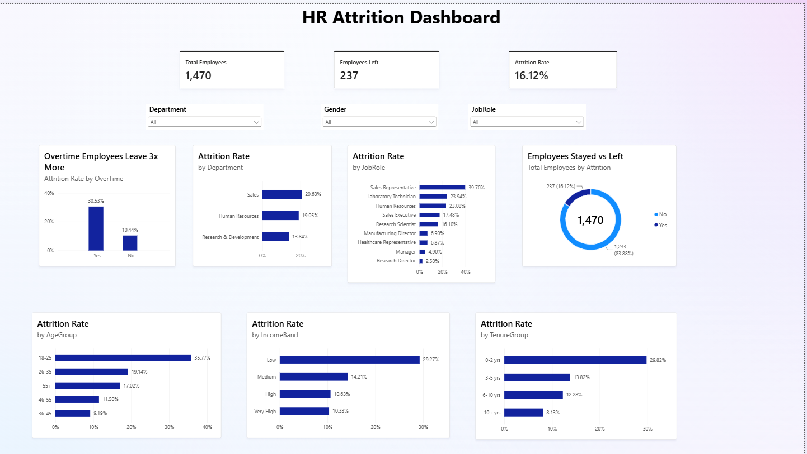

# hr-attrition-analysis
HR attrition analysis using Python and Power BI
# HR Attrition Analysis (Python + Power BI)

Analysis of employee attrition for 1,470 employees to find **why people leave** and **which groups are most at risk**, with an interactive Power BI dashboard and retention recommendations.



## Problem Statement

Employee attrition is costly: companies lose skilled people and spend more on hiring and training. This project identifies the main drivers of attrition so that HR can act early.

## Dataset

- **Source:** [IBM HR Analytics Employee Attrition & Performance](https://www.kaggle.com/datasets/pavansubhasht/ibm-hr-analytics-attrition-dataset) (public dataset on Kaggle)
- **Size:** 1,470 employees, 35 columns
- **Note:** This is a fictional dataset created by IBM data scientists for learning purposes. It is not real company data.

## Tools Used

- **Python:** pandas, Matplotlib, Seaborn
- **Power BI Desktop:** dashboard, DAX measures
- **GitHub:** version control and publishing

## Project Steps

1. **Data cleaning:** checked missing values and duplicates (none found), dropped columns with a single value (`EmployeeCount`, `StandardHours`, `Over18`).
2. **Feature engineering:** created `AttritionFlag`, `AgeGroup`, `IncomeBand` and `TenureGroup`.
3. **Exploratory analysis:** calculated attrition rate across departments, job roles, overtime, age, income, tenure, marital status, travel, job satisfaction and work-life balance.
4. **Visualization:** bar charts, pie chart, boxplot and correlation heatmap (saved in `images/`).
5. **Dashboard:** built an interactive Power BI dashboard with KPI cards, charts and slicers.

## Key Findings

| Metric | Result |
|---|---|
| Total employees | 1,470 |
| Employees who left | 237 |
| **Overall attrition rate** | **16.12%** |

1. **Overtime is the biggest driver.** Employees working overtime leave at **30.5%**, versus **10.4%** for those who do not.
2. **Low income means higher attrition.** The lowest income band leaves at **29.3%**, while the high income bands leave at about **10%**.
3. **New and young employees leave the most.** Employees with 0-2 years at the company leave at **29.8%**, and those aged 18-25 at **35.8%**.
4. **Some roles are far riskier.** Sales Representatives have the highest attrition at **39.8%**, followed by Laboratory Technicians at **23.9%**. Research Directors (2.5%) and Managers (4.9%) are the most stable.
5. **Sales is the riskiest department** at **20.6%**, compared with **13.8%** in Research & Development.
6. **Frequent travel and single status raise the risk.** Frequent travellers leave at **24.9%** (vs 8.0% for non-travellers), and single employees at **25.5%** (vs about 10-12% for divorced and married employees).
7. **Satisfaction matters.** Employees with low job satisfaction leave at **22.8%**, versus **11.3%** for very high satisfaction.

## Recommendations

1. Review the overtime policy and redistribute workload in high-overtime teams.
2. Revisit pay for low-income and high-risk roles, especially Sales Representatives and Laboratory Technicians.
3. Improve onboarding and mentoring during the first 2 years.
4. Reduce the travel burden or offer flexibility for frequent travellers.
5. Run regular job satisfaction and work-life balance surveys and act on low scores early.

## Limitations

These factors overlap (for example, young employees are often also new and lower paid). The analysis shows **which groups are at higher risk**, not what causes people to leave.

## Dashboard (Power BI)

- **KPI cards:** Total Employees, Employees Left, Attrition Rate
- **Charts:** attrition rate by overtime, department, job role, age group, income band and tenure
- **Donut chart:** employees stayed vs left
- **Slicers:** Department, Gender, JobRole

DAX measures used:

```
Total Employees = COUNTROWS(hr_attrition_cleaned)
Employees Left = SUM(hr_attrition_cleaned[AttritionFlag])
Attrition Rate = DIVIDE([Employees Left], [Total Employees], 0)
```

## Repository Structure

```
hr-attrition-analysis/
├── hr_attrition_analysis.py       # Python cleaning and analysis script
├── hr_attrition_cleaned.csv       # Cleaned data used in Power BI
├── HR_Attrition_Dashboard.pbix    # Power BI dashboard
├── dashboard.png                  # Dashboard screenshot
├── images/                        # Charts generated by the script
└── README.md
```

## How to Run

1. Download the dataset from Kaggle and place the CSV in the project folder.
2. Install the libraries:
   ```
   pip install pandas matplotlib seaborn
   ```
3. Run the script:
   ```
   python hr_attrition_analysis.py
   ```
4. Open `HR_Attrition_Dashboard.pbix` in Power BI Desktop.

## Author

nikita kharat
